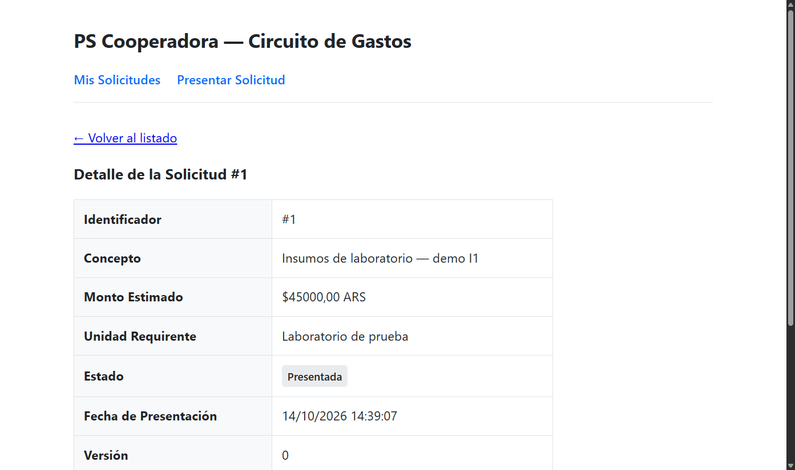
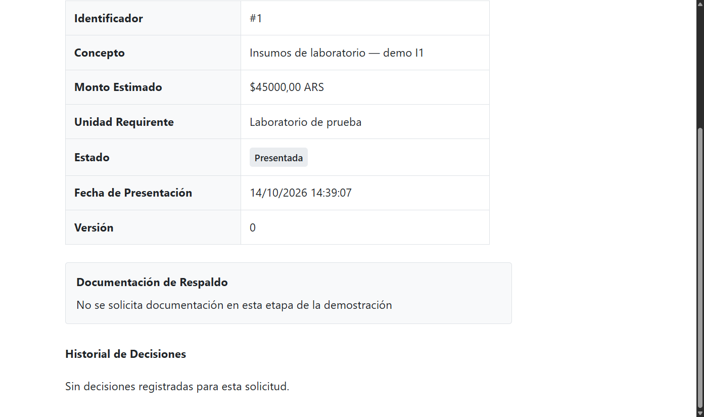
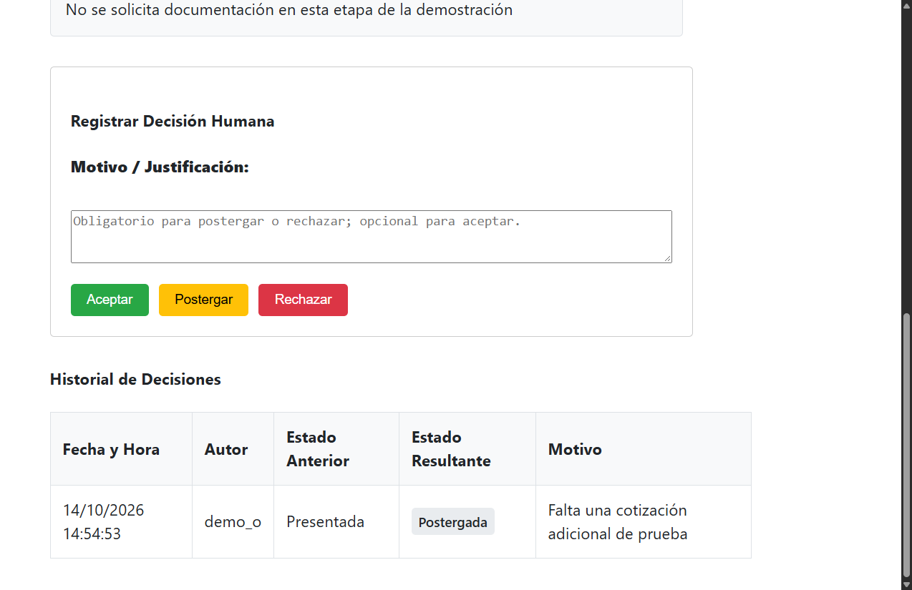
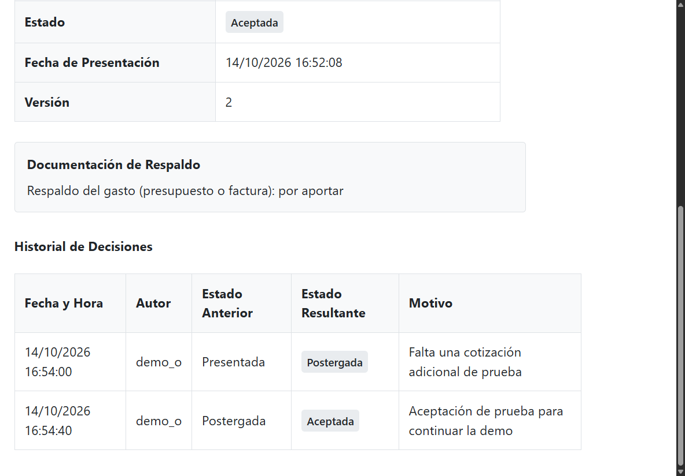
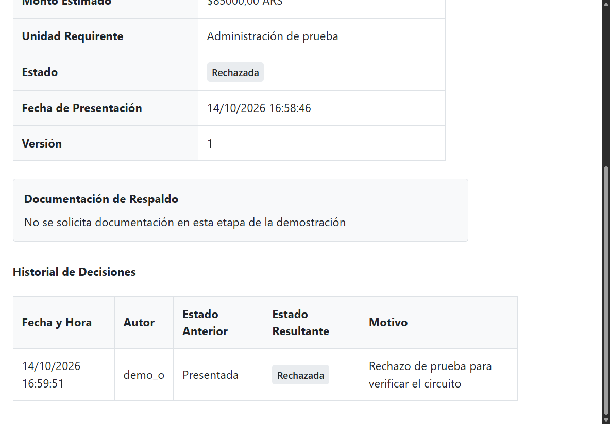
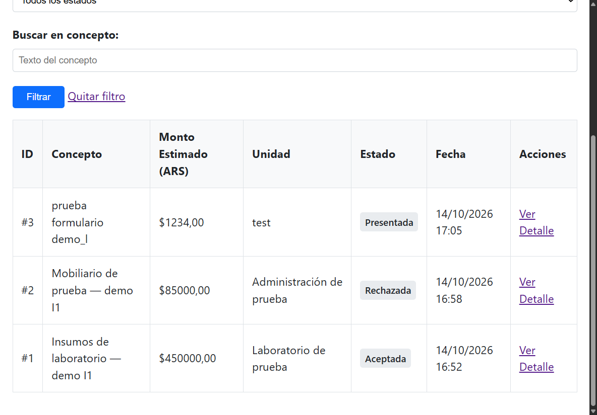
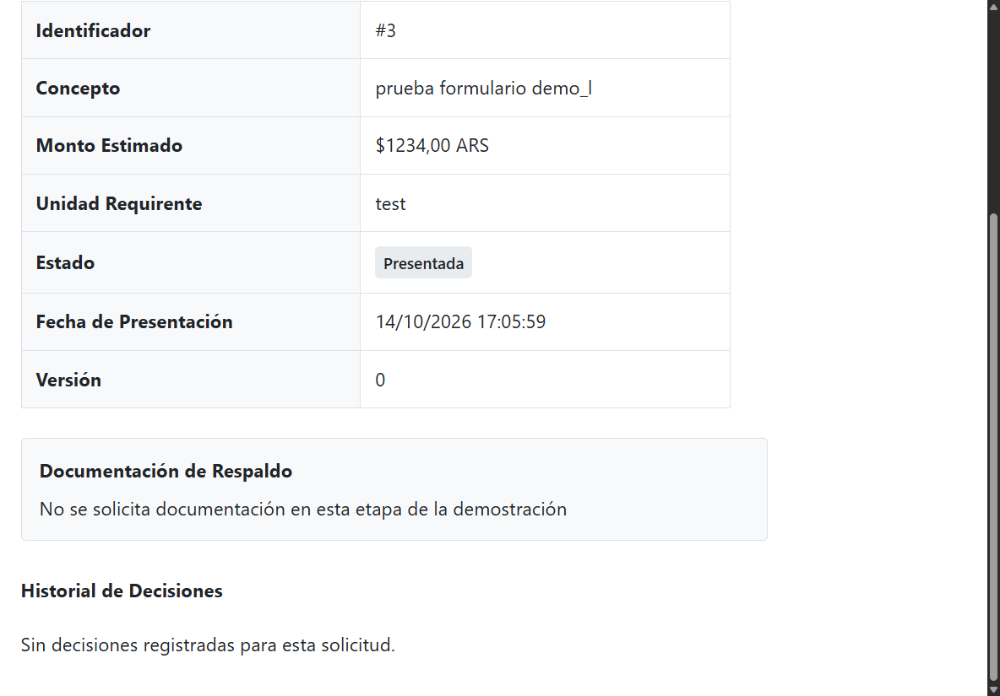
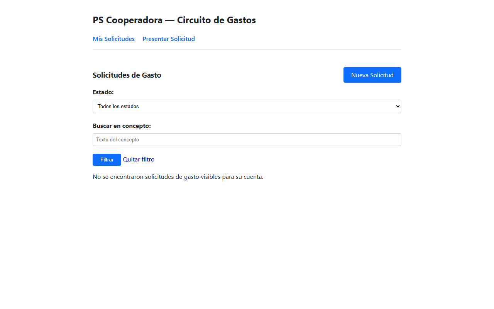
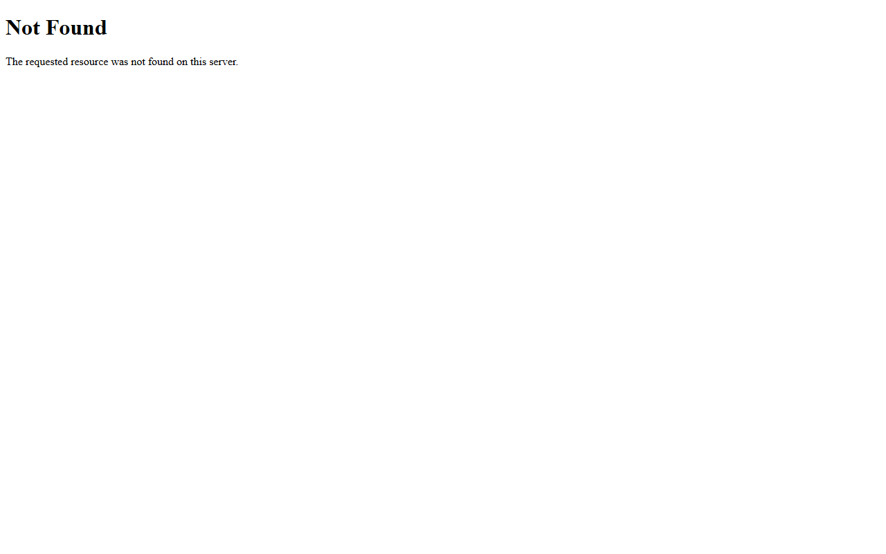

# Evidencia del recorrido de Franco - I1/T06

Fecha: 14/10/2026. Complementa el [acta tecnica](../i1-t06-acta-tecnica.md)
y la Issue [#8](https://github.com/MatiasAFernandez/PS_Cooperadora/issues/8).
Franco realizo el recorrido manual y aporto las capturas. Los resultados de
comprobaciones tecnicas complementarias se identifican por separado en el acta.

Version recorrida: [60f21f1](https://github.com/MatiasAFernandez/PS_Cooperadora/tree/60f21f156c2d30ce7240cb10ce0308071f80daa1),
ensayo combinado de #37 (`35be7cc`) y #17 (`85dbd54`), sobre main `0a9939b`.
Entorno: Windows, Python 3.11.9, Django 5.2.17 y PostgreSQL 17.11.

## Seleccion y trazabilidad

Se revisaron seis PNG y un PDF de seis paginas con once imagenes. Se eligieron
siete imagenes extraidas del PDF, sin alterar sus pixeles. Los PNG con pestanas
del entorno privado, los accesos sin valor adicional y capturas redundantes no
se publican. Los originales se conservaron sin cambios fuera de Git.
El [manifiesto](manifest.json) identifica pagina, imagen fuente y SHA-256.
Adicionalmente se incorporan dos capturas tecnicas posteriores de una sesion real
de B, identificadas como T01/T02; no se atribuyen a la captura manual original.

| ID | Contenido visible | Fuente en PDF | Limite |
|---|---|---|---|
| E01 | Solicitud #1 presentada, ARS 45000 y version 0 | Pagina 1, imagen 1 | Primer tramo, fecha visible 14:39:07 |
| E02 | Detalle de #1, mensaje inicial H4 e historial vacio | Pagina 1, imagen 2 | Complementa E01; no demuestra por si solo la identidad de la sesion |
| E03 | Evento presentada a postergada, demo_o y motivo | Pagina 3, imagen 1 | Primer tramo, evento 14:54:53; tambien muestra el boton Postergar ofrecido tras postergar |
| E04 | Aceptada/version 2, H4 por aportar y dos eventos con motivos | Pagina 3, imagen 2 | Repeticion posterior; fecha de alta visible 16:52:08. El ID se relaciona con E06 y el relato |
| E05 | Rechazada/version 1, H4 inicial y evento con motivo | Pagina 5, imagen 1 | Imagen original recortada en sus bordes; el ID se relaciona con E06 y el relato |
| E06 | Listado con #1 aceptada, #2 rechazada y #3 presentada | Pagina 5, imagen 2 | La cuenta que consulta no se identifica en esta imagen; atribucion de L por reporte directo |
| E07 | #3 presentada/version 0, historial vacio y sin panel de decision | Pagina 6, imagen 1 | Caso activo de lectura; atribucion de L por reporte directo, no solo por botones ausentes |

Las fechas visibles corresponden a dos corridas separadas por la interrupcion
del entorno. No se presentan como una unica secuencia continua ni se suman como
casos nuevos distintos. Los detalles de la recuperacion estan en el acta.

## Cobertura y pendientes

El relato directo de Franco tambien registra recargas, consulta de A, listado de B
sin gastos ajenos y Not Found por las URLs de #1 y #2. El conjunto recibido no
contiene capturas de esos Not Found ni del mensaje de validacion duplicado.
No se inventan ni se presentan imagenes posteriores como capturas originales.

La [comprobacion visual complementaria de B](verificacion-tecnica-b.json) se hizo
despues, en navegador Chromium con login real: listado 200 sin solicitudes ajenas
y detalles #1/#2 con 404. No envio decisiones ni modifico solicitudes/historial.
T01 muestra el listado vacio; T02 muestra la respuesta generica 404. Las dos URLs
produjeron imagenes identicas y se publica una sola, con ambos resultados HTTP
registrados. Esta evidencia es tecnica, distinta del recorrido manual de Franco.

La denegacion HTTP 403 a L con sesion y CSRF validos y la ausencia de cambios
fueron verificadas tecnicamente en #3; no son una captura manual de Franco.
La suite combinada aprobo 151 pruebas; CT-05 queda como evidencia automatizada.
La seleccion final y la conformidad de ambos integrantes con el acta siguen
pendientes. Este paquete no cierra #8 ni valida H1-H4 ante Cooperadora (#9).

## Capturas

### E01 - Presentacion

### E02 - Mensaje inicial y ausencia de decisiones

### E03 - Postergacion e historial

### E04 - Aceptacion, historial y respaldo pendiente

### E05 - Rechazo

### E06 - Consulta del listado

### E07 - Consulta de una solicitud abierta

### T01 - Comprobacion tecnica posterior: listado de B

### T02 - Comprobacion tecnica posterior: respuesta generica a objeto ajeno

